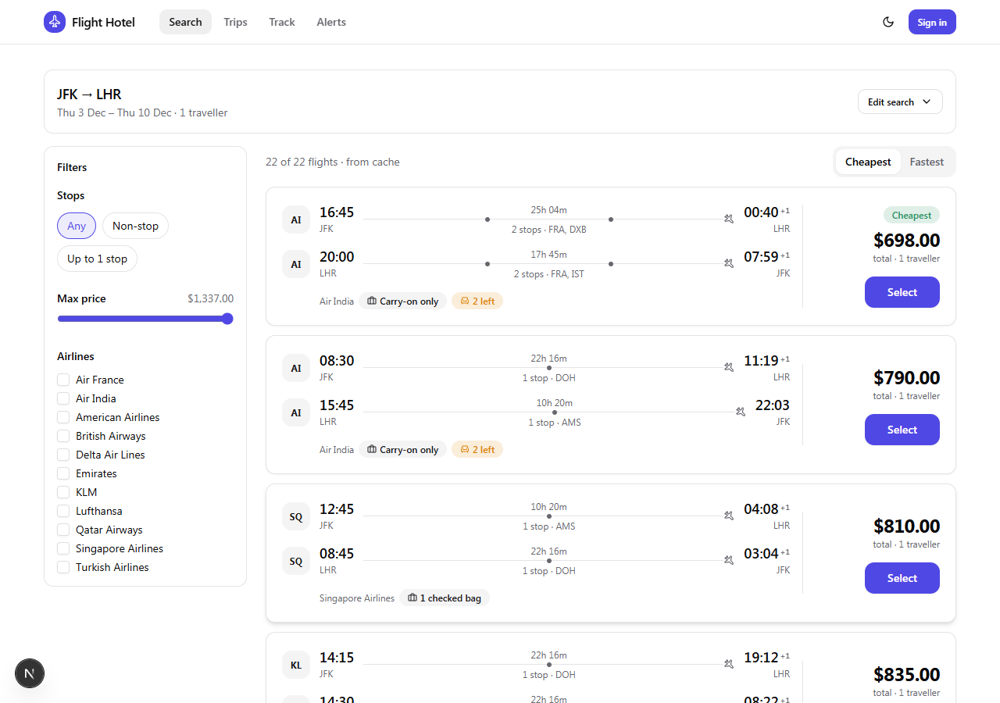
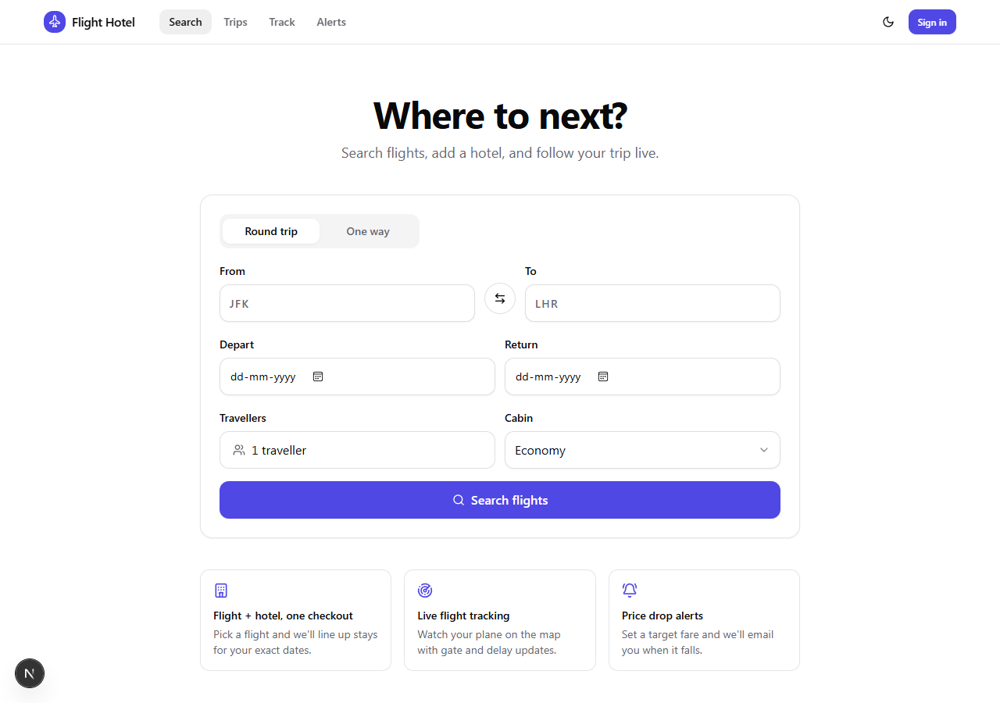
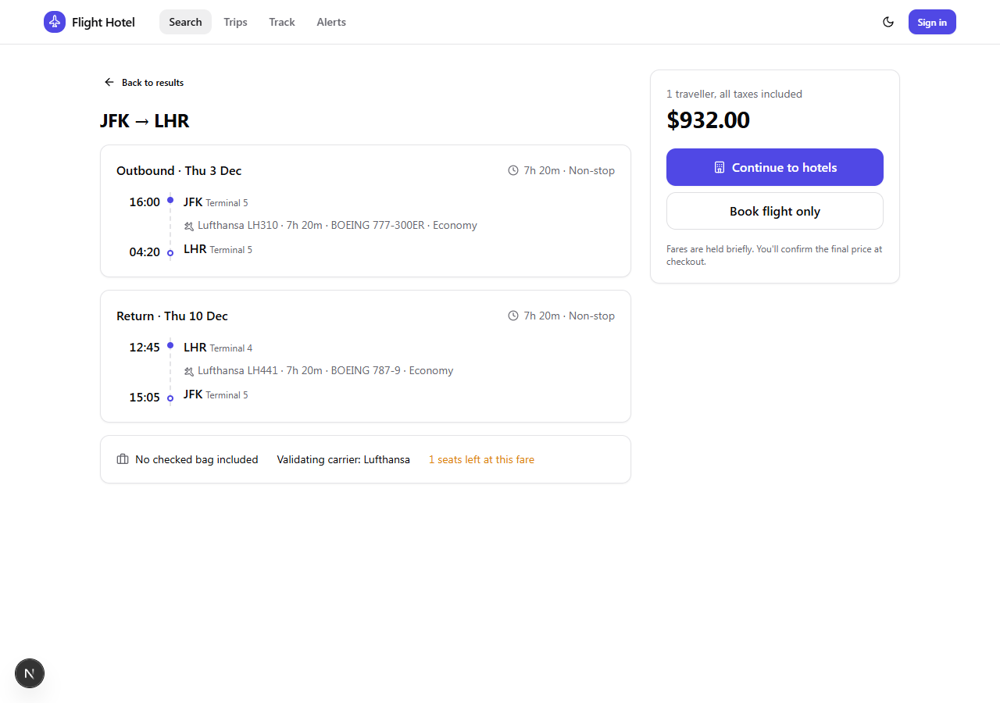
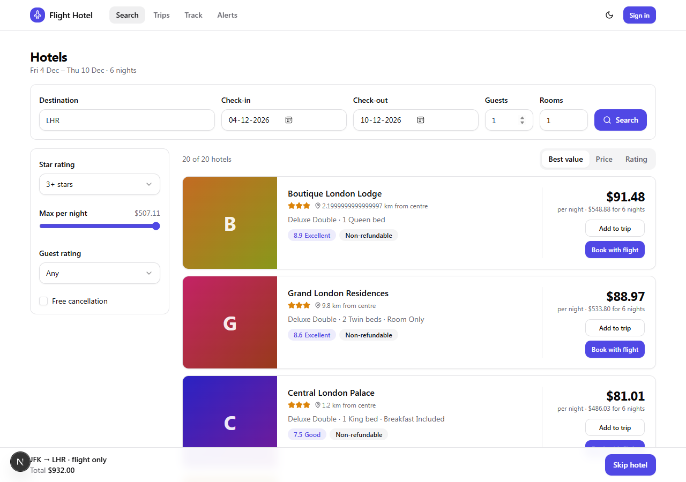
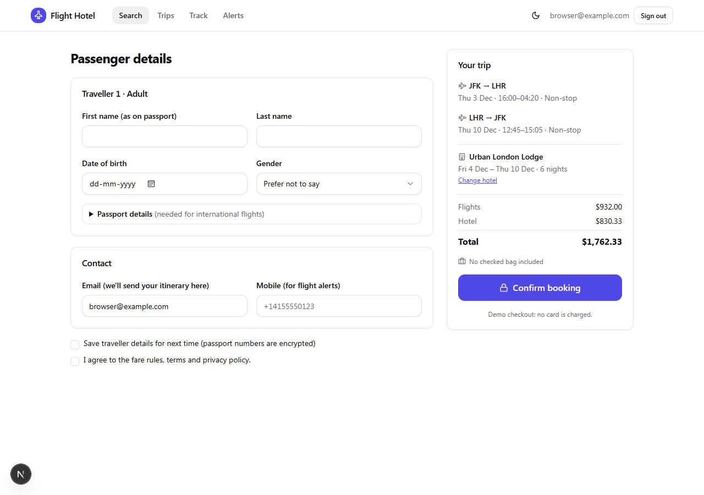
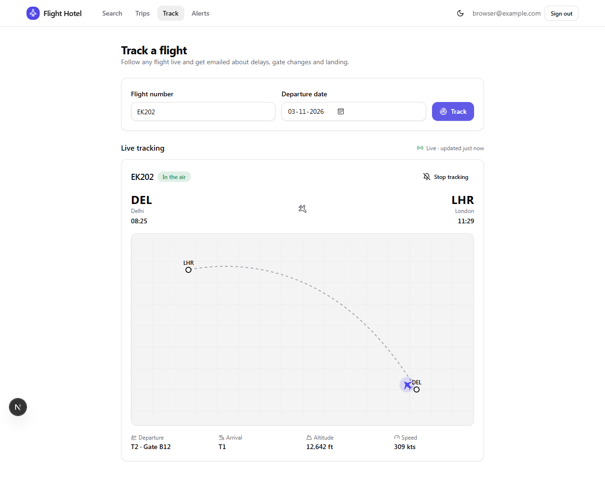
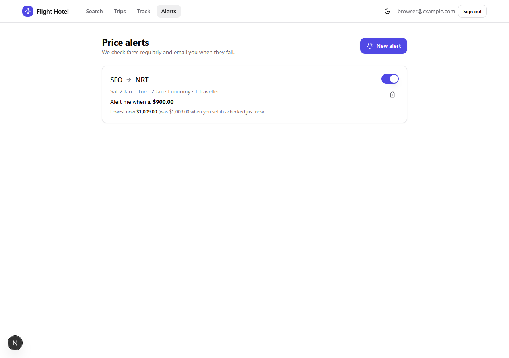
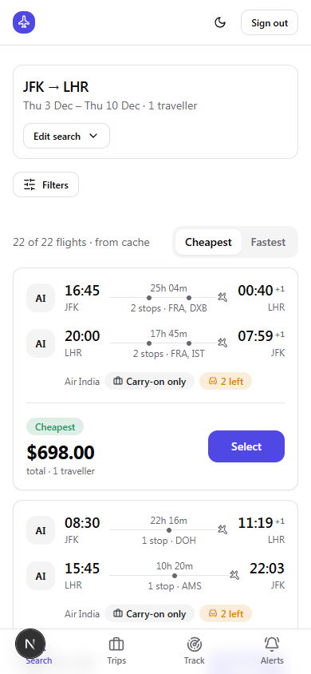
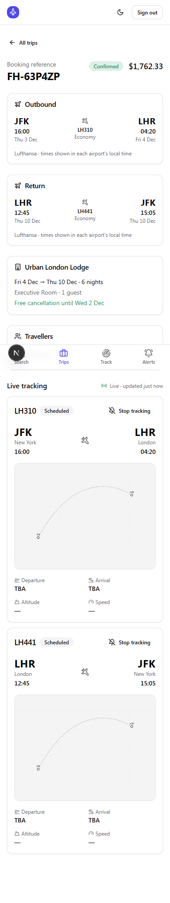

<div align="center">

# ✈︎ Flight Hotel

**Search flights, add a hotel, book both in one checkout, and follow your plane live on a map.**

A full-stack travel platform: real-time flight and hotel search, combined bookings, live flight tracking over Server-Sent Events, price-drop alerts, and transactional email, built as a typed TypeScript monorepo.




</div>

> **Runs with zero API keys.** Without credentials, the app uses deterministic mock flight, hotel and tracking
> providers, so every screen and flow works out of the box. Plug in Amadeus / FlightAware / Resend / Mapbox when you're ready.

---

## Features

| | |
|---|---|
| 🔎 **Flight search** | One-way and round-trip, cabin class, travellers. Cached, rate-limited, sorted by price or duration, filtered by stops, airline and price, all instantly and client-side. |
| 🏨 **Hotels linked to your flight** | Pick a flight and the hotel search is pre-filled with your destination and exact dates. Filter by stars, price, free cancellation and guest rating; ranked by a blend of price and rating. |
| 🧾 **One checkout** | Flight + hotel booked in a **single database transaction**: idempotent, price-guarded, with encrypted passport data. |
| 🛰️ **Live tracking** | Plane position, altitude, speed, ETA, gate and terminal, streamed over **SSE** to a live map (Mapbox GL, with a built-in SVG fallback). Track by booking or by flight number. |
| 📬 **Email notifications** | Booking confirmation, flight status (delay / gate change / cancelled / landed), price drops and 24 h / 3 h check-in reminders. Dark-mode-aware React Email templates, one-click unsubscribe. |
| 🔔 **Price alerts** | Target price or % drop. One search serves every watcher of the same route, and users are alerted only on a *further* drop. |
| 📱 **Mobile-first UI** | Responsive layouts, bottom tab bar on phones, dark mode, accessible forms and focus states, loading skeletons and error states on every page. |

## Screenshots

<table>
  <tr>
    <td width="50%"><br/><sub><b>Search</b>: validation, recent searches</sub></td>
    <td width="50%"><br/><sub><b>Flight details</b>: itinerary, layovers, baggage</sub></td>
  </tr>
  <tr>
    <td><br/><sub><b>Hotels</b> for the flight's dates, with filters</sub></td>
    <td><br/><sub><b>Checkout</b>: passenger details and trip summary</sub></td>
  </tr>
  <tr>
    <td><br/><sub><b>Live tracking</b> map and flight facts</sub></td>
    <td><br/><sub><b>Price alerts</b></sub></td>
  </tr>
</table>

<details>
<summary>Mobile views</summary>
<p>


</p>
</details>

## Quick start

**Requirements:** Node 20+, [pnpm](https://pnpm.io), PostgreSQL 16 (Redis optional in dev).

```bash
git clone https://github.com/reddypranith80-max/AI-AGENT.git && cd AI-AGENT
pnpm install

cp .env.example .env          # set AUTH_SECRET:  openssl rand -base64 32
docker compose up -d          # Postgres + Redis  (or point DATABASE_URL at your own Postgres)

pnpm db:migrate               # create tables
pnpm --filter @fh/db seed:reference   # airports + airlines (OpenFlights dataset)

pnpm dev                      # → http://localhost:3000
```

Sign in with **any email** (dev login is on when `AUTH_DEV_LOGIN=true` and `NODE_ENV` isn't production).
Booking confirmation and status emails are printed to the server console until you add a Resend key.

For the production topology run the background worker too (needs `REDIS_URL`):

```bash
pnpm worker                   # tracking polls, price scans, emails, reminders
```

Without Redis everything still works in a single process: events run in-process and the SSE endpoint polls on its own.

## Architecture

```
                    ┌──────────────────────────────────────────────┐
 Browser / PWA ───▶ │ apps/web  (Next.js 15 App Router)            │
 (React, SSE)       │  pages · route handlers · /api/track  (SSE)  │
                    └───────┬─────────────────────────┬────────────┘
                            │ services                │ enqueue / pub-sub
                   ┌────────▼─────────┐       ┌───────▼────────────┐
                   │ packages/api     │◀─────▶│ Redis              │
                   │ search · booking │       │ cache · rate limit │
                   │ tracking · alerts│       │ BullMQ · pub/sub   │
                   │ notifications    │       └───────┬────────────┘
                   └───┬────────┬─────┘               │ consume
              Prisma   │        │ adapters    ┌───────▼────────────┐
              ┌────────▼───┐  ┌─▼───────────┐ │ apps/worker        │
              │ PostgreSQL │  │ Amadeus     │ │ tracking · alerts  │
              └────────────┘  │ FlightAware │ │ emails · reminders │
                              │ Mapbox      │ └────────────────────┘
                              │ Resend      │
                              └─────────────┘
```

**Design decisions worth knowing**

- **Provider adapters.** Every vendor sits behind an interface (`FlightProvider`, `HotelProvider`, `TrackingProvider`); normalized types stop vendor schemas leaking into the app. Swap Amadeus for Duffel without touching the UI.
- **Search is cache-first.** Normalize → Redis (5–10 min) → coalesce identical in-flight requests → outbound rate limit → vendor 429s surface as `503 + Retry-After`. Sort/filter are pure functions shared by server and client, so they never refetch.
- **Flight ↔ hotel link.** Hotel params derive from the chosen flight (`hotelSearchFromFlight`). In the database, `booking_hotels.bookingId` references the same `bookings` row as `booking_flights`, written together in one transaction.
- **Live tracking pipeline.** A 30 s scheduler claims due flights → one poll job each → `applySnapshot()` updates the row, appends a position, records status events, pushes to SSE via pub/sub and emits `flight.status.changed`. Cadence adapts (6 h → 30 min → 5 min → ~90 s airborne) and stops on landed / cancelled / diverted, or when nobody is watching.
- **Idempotent email.** All mail goes through one path: preferences → suppression list → dedupe key → render → send. Retried jobs never double-send. Check-in reminders are delayed jobs backed by a DB sweeper.
- **Times are honest.** Flight search returns airport-local wall-clock times (never shifted into the viewer's timezone); bookings convert to UTC with the airport's IANA zone, DST-safe.
- **Security.** Passport numbers are AES-256-GCM encrypted; sessions are JWT; every query is user-scoped; webhooks are signature-verified and replay-protected; per-IP / per-user rate limits; signed unsubscribe tokens.

## Tech stack

| Layer | Choice |
|---|---|
| Frontend | Next.js 15 (App Router), React 19, Tailwind CSS, shadcn/ui-style Radix primitives, TanStack Query, React Hook Form + Zod |
| Backend | Next.js route handlers, Server-Sent Events, Auth.js v5 |
| Data | PostgreSQL 16, Prisma 6 (soft-delete client extension, hand-written SQL migration for partial indexes & CHECKs) |
| Async | BullMQ + Redis (jobs, schedulers, pub/sub) with in-process fallbacks |
| Email | React Email + Resend |
| Maps | Mapbox GL JS (SVG fallback with no token) |
| Providers | Amadeus (flights, hotels), FlightAware AeroAPI (tracking), Mapbox Geocoding, plus keyless mocks |
| Tooling | pnpm workspaces, strict TypeScript, Playwright (UI verification) |

## Project structure

```
apps/
  web/                 Next.js app: pages, route handlers, UI components, hooks
  worker/              BullMQ consumers + repeatable schedulers
packages/
  domain/              Shared types, Zod schemas, pure logic (no I/O): flights, hotels, booking, tracking, alerts, time zones
  db/                  Prisma schema, migrations, client, reference-data seed
  providers/           Vendor adapters (Amadeus, FlightAware, Mapbox) + mock providers
  api/                 Server services: search, booking, tracking, notifications, alerts, cache, pub/sub, queues
  emails/              React Email templates
```

## Configuration

Copy `.env.example` → `.env`. Everything is optional except the database and `AUTH_SECRET`.

| To enable | Set |
|---|---|
| Live fares & hotels | `AMADEUS_CLIENT_ID`, `AMADEUS_CLIENT_SECRET`, `AMADEUS_BASE_URL` |
| Live flight tracking | `TRACKING_PROVIDER=flightaware`, `FLIGHTAWARE_API_KEY` |
| Real email | `RESEND_API_KEY`, `EMAIL_FROM`, `RESEND_WEBHOOK_SECRET` (point the webhook at `/api/webhooks/resend`) |
| Mapbox map | `NEXT_PUBLIC_MAPBOX_TOKEN` |
| Google sign-in / magic links | `AUTH_GOOGLE_ID` / `AUTH_GOOGLE_SECRET`, or `RESEND_API_KEY` |
| Background jobs | `REDIS_URL` and `pnpm worker` |
| Production | `AUTH_SECRET`, `PII_ENCRYPTION_KEY` (32 bytes, base64), `UNSUBSCRIBE_SECRET` |

## Testing

```bash
pnpm typecheck                     # all packages, strict mode
pnpm --filter @fh/api test:e2e     # integration test against DATABASE_URL
```

The integration test covers the combined booking transaction, idempotent retries, stale-price / expired-offer /
wrong-party guards, encrypted passports, tracking diffs → status events → emails, no duplicate emails on
redelivery, and stop-tracking. The UI flow (search → hotels → login → booking → live tracker → alerts, on desktop and
mobile) was verified end-to-end in a real browser.

## Roadmap

- [ ] Stripe payments (`PAYMENT_MODE=stripe` already holds bookings `PENDING` until a payment webhook confirms)
- [ ] Real ticketing via Duffel orders (PNR + ticket numbers)
- [ ] Airport autocomplete (trigram index is already in the database)
- [ ] Web push for delay alerts
- [ ] Hosted deployment guide (Vercel + Fly/Railway)

## License

MIT
